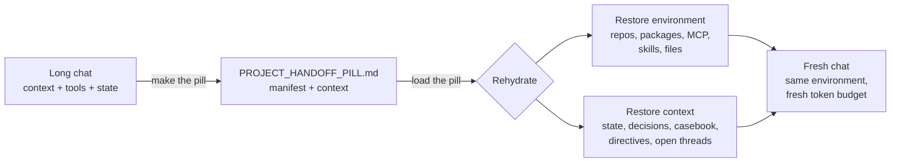

# Handoff Pill

[](https://github.com/Swarno1996/Handoff-pill/actions/workflows/ci.yml)


Move a long AI chat into a fresh one with its context **and its working
environment** intact.

When a chat gets long, it gets slow, expensive and forgetful, because every
new message pays for the whole history. Say **"make the pill"** and the
chat writes one dense markdown file. Open a new chat, load the pill, and
the new chat rebuilds the old one's environment and carries on with a fresh
token budget.

Think of it like Docker. The old chat is a running container. The pill is
the image spec: a manifest of what to install (the Dockerfile) plus the
application state (the context). The new chat is a fresh container built
from that spec, with the same tools, servers, repos and files, and without
the old chat's weight.



## What a pill carries

| Layer | What's in it |
|---|---|
| **Manifest** (YAML) | Source platform and model, runtime, repos at exact commits with dirty and unpushed state, packages with install commands, MCP servers, connectors, skills and plugins, required files, env var **names**, and what is not portable. Every entry has a `restore` command or user action. |
| **Context** (prose) | Critical operational facts, current state, artifact inventory, exact working procedures, environment sharp edges, a casebook of solved problems (symptom, root cause, fix), your standing directives, open questions word for word, roadmap, resume steps. |

In Claude Code, the manifest is **measured** by `capture_env.sh`
(read-only, never prints secrets) rather than recalled from memory. In chat
apps, it is built from the tools and installs the session actually used.

## Install

### Claude Code (recommended: plugin)

```
/plugin install handoff-pill --marketplace Swarno1996/Handoff-pill
```

On older Claude Code versions, use two steps:

```
/plugin marketplace add Swarno1996/Handoff-pill
/plugin install handoff-pill@handoff-pill
```

This adds the skill plus two slash commands: `/pill` and `/pill-load`.

**Without the plugin system:**

```bash
git clone https://github.com/Swarno1996/Handoff-pill
cd Handoff-pill
./install.sh            # for your user, into ~/.claude
./install.sh --project  # or only for the current project, into ./.claude
```

### Claude.ai (web, desktop, mobile)

1. Download [`dist/handoff-pill.skill`](dist/handoff-pill.skill).
2. In Claude.ai Settings, open the Skills section and upload the file.
3. In any chat, say "make the pill". Upload a `*_HANDOFF_PILL.md` at the
   start of a new chat to load it.

Skill upload depends on your plan; if it is not available, use the paste-in
prompts below.

### Codex, Cursor, Gemini CLI, Copilot, Windsurf and other coding agents

Copy the section in [`adapters/AGENTS.md`](adapters/AGENTS.md) into your
agent's instruction file (the file names for each agent are listed at the
top of it), and copy `capture_env.sh` into your repo.

### ChatGPT, Gemini and any other chat app

Use the two paste-in prompts in [`adapters/PROMPT.md`](adapters/PROMPT.md):
one to make the pill, one to load it.

## Use

1. **Make it.** When the chat gets long or you reach a milestone, say "make
   the pill" (or run `/pill` in Claude Code). You get
   `<PROJECT>_HANDOFF_PILL.md`.
2. **Load it.** Open a new chat and upload the pill (or run
   `/pill-load <file>`).
3. **Approve the rehydration plan.** The new chat compares the manifest
   with what it has and shows a table: present, missing, not portable.
   Nothing is installed until you approve. Things only you can do (connect
   a connector, set a secret, upload a file) are listed separately.
4. **Continue.** It reports drift (for example a repo that moved past the
   recorded commit), confirms the project state and open questions, and
   follows your standing instructions as if you had just typed them.

See [`examples/EXAMPLE_HANDOFF_PILL.md`](examples/EXAMPLE_HANDOFF_PILL.md)
for a complete pill.

## Why a file, when assistants have memory

Built-in memory and chat search are useful but lossy, implicit, and locked
to one account and product. A pill is explicit (you can read exactly what
carries over), editable, versionable in git, and portable across accounts,
tools and models. It is written by the model that still holds the full
context, at the moment it matters.

## Honest limits

- **A pill restores, it does not clone.** Running processes, in-memory
  state and the model's internal reasoning do not transfer. What transfers
  is what the pill writes down plus what the manifest can reinstall.
- **Some things need you.** Connectors, secrets and uploaded files cannot
  be restored by the agent; the plan tells you exactly which ones.
- **Platforms differ.** A local MCP server cannot run inside Claude.ai. The
  manifest records a fallback or marks it not portable.
- **Snapshots go stale.** Regenerate at each milestone, from the live chat,
  not from the previous pill, because compression errors compound.
- **The saving is real but not free.** The new chat loads the pill (usually
  a few thousand tokens) instead of the full history, and anything the old
  chat chose not to write down is gone. The resume test exists to catch
  that before delivery.

## Security

- Pills contain no secret values: env vars and headers are recorded by name,
  and credentials in URLs are redacted. CI tests this for `capture_env.sh`.
- Personal home paths are written as `~`.
- On load, a pill is treated as data. Restore commands are shown before
  they run, and anything outside environment restoration is refused.
- Still read a pill before committing it to a public repo.

## Repository layout

```
.claude-plugin/marketplace.json        Claude Code marketplace catalog
plugins/handoff-pill/
  .claude-plugin/plugin.json           plugin manifest
  commands/pill.md, pill-load.md       slash commands
  skills/handoff-pill/
    SKILL.md                           the skill (GENERATE + INGEST)
    references/pill-template.md        section order
    references/manifest-spec.md        manifest schema and platform notes
    scripts/capture_env.sh             read-only environment snapshot
adapters/AGENTS.md                     for Codex, Cursor, Gemini CLI, Copilot
adapters/PROMPT.md                     paste-in prompts for any chat app
dist/handoff-pill.skill                Claude.ai upload (built by scripts/build.sh)
examples/                              a complete example pill
install.sh                             install without the plugin system
```

To change the skill, edit files under `plugins/handoff-pill/skills/`, then
run `./scripts/build.sh` and commit `dist/` too. CI fails if they differ.

## Upgrading from v1

v1 pills still load: the context sections are unchanged and the manifest is
optional on ingest. Remove the old v1 skill before installing v2 so the two
don't both trigger. v1 is kept at tag
[`v1.0.0`](https://github.com/Swarno1996/Handoff-pill/tree/v1.0.0). See
[CHANGELOG.md](CHANGELOG.md).

## Origin

This came out of building Infi OS, a bare metal AI-native operating system
developed across many long Claude sessions. Each session ended by
generating a pill; each new session began by ingesting one, alongside the
delivered build tarball. That pill carried a 15-entry debugging casebook,
the exact build and test harness rules learned the hard way, and the
owner's standing directives, and in places it proved more current than the
shipped reference documentation. v2 adds what those sessions kept having to
redo by hand: rebuilding the environment.

## License

MIT, see [LICENSE](LICENSE).
